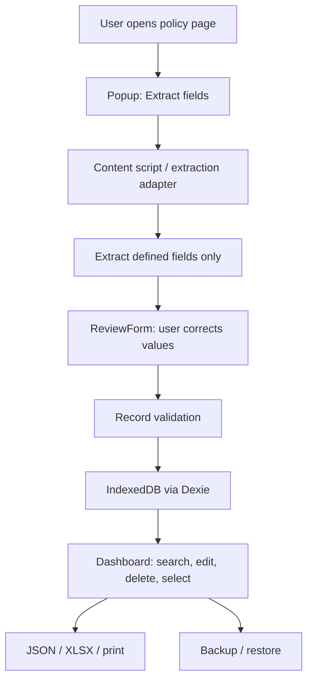

# Codebase Report — Policy Extractor

## 1. Overview

**Policy Extractor** is a local-first Chrome Manifest V3 extension intended for one authorized user. It manually extracts a defined set of policy fields from a company portal, allows the user to review and edit those fields, stores records in IndexedDB, and offers record management, export, and backup/restore.

The project is a React/Vite-based browser extension—not a server-backed web application. Its data path is designed to remain within the browser.

## 2. Directory structure at a glance

```text
Policy Extractor/
├── agent.md
├── security.md
├── prompt.json
├── README.md
├── edge-cases.md
├── test-report.md
├── package.json / package-lock.json
├── manifest.json
├── vite.config.js
├── tailwind.config.js
├── postcss.config.js
├── popup.html
├── dashboard.html
├── src/
│   ├── background/
│   ├── content/
│   ├── extraction/
│   ├── schema/
│   ├── storage/
│   ├── utils/
│   ├── styles/
│   ├── popup/
│   ├── review/
│   ├── dashboard/
│   └── export/
├── tests/
└── dist/                  # generated build output
```

## 3. Root-level files

- **`README.md`** — Main user/developer documentation: installation, loading the extension in Chrome, workflow, configuration, export/backup, limitations and security notes.
- **`agent.md`** — Instructions and development constraints intended for coding agents working on the repository. Defines the project purpose, working principles, milestones and completion expectations.
- **`security.md`** — Security/privacy guide covering scope, access, local data, storage, backups, exports, logging and review checklist.
- **`prompt.json`** — A structured project prompt/configuration document. It appears intended to capture project requirements and instructions for an AI-assisted implementation workflow.
- **`edge-cases.md`** — Scenario catalogue covering extraction, validation, workflow, storage, backups, document/PDF handling, exports, permissions, security and accessibility.
- **`test-report.md`** — Project's written test/bug-fix report and manual testing status.
- **`package.json`** — npm scripts and dependencies. React, React DOM, Dexie, and XLSX are runtime dependencies; Vite, Vitest, Tailwind, ESLint and related tooling are development dependencies.
- **`package-lock.json`** — Locked npm dependency tree/version metadata.
- **`manifest.json`** — Chrome extension Manifest V3 metadata, popup, background service worker, content-script configuration, permissions, CSP and web-accessible resource declarations. Portal domain entries are placeholders and must be configured.
- **`vite.config.js`** — Build configuration. Builds popup, dashboard, background service worker and content-script entry points; copies the manifest into `dist`.
- **`tailwind.config.js`** — Tailwind CSS content paths and configuration.
- **`postcss.config.js`** — PostCSS plugin configuration for Tailwind and Autoprefixer.
- **`popup.html`** — HTML shell for the extension popup.
- **`dashboard.html`** — HTML shell for the records dashboard.

## 4. `src/` — application source

### `src/extraction/`
- **`adapter.js`** — Adapter registry/dispatch layer. Chooses an adapter based on the page origin/pattern and runs extraction against a document. This is the central place to connect the extension to a specific portal's DOM.
- **`placeholder-adapter.js`** — Example/stub adapter for the currently unconfigured portal integration. It provides placeholder extraction behavior rather than a production portal-specific mapping.

### `src/content/`
- **`content.js`** — Content-script entry point that runs in the target page context as configured by the manifest. It participates in the popup-to-page extraction workflow and communicates extraction results/errors without treating page data as trusted.

### `src/background/`
- **`service-worker.js`** — Manifest V3 background service worker. Handles extension-level coordination and message/action behavior outside the popup or page content script.

### `src/schema/`
- **`fieldDefs.js`** — Single source of truth for the fields the extension handles: IDs, labels, types, requirements and related field metadata. Also exports lookup/required-field helpers.
- **`record.js`** — Record lifecycle and validation logic: creation, updates, schema version, field validation, import validation and source-origin handling. UI and storage code rely on this layer for consistent record structure.

### `src/storage/`
- **`db.js`** — Dexie/IndexedDB database setup and schema definition. Provides the local records database abstraction.
- **`backup.js`** — Backup/restore functions. Produces a backup file, reads and previews imports, and commits imported records with duplicate-handling strategies.

### `src/utils/`
- **`normalize.js`** — Text/data normalization helpers, including whitespace, date and currency normalization, and spreadsheet-cell protection-related text handling.
- **`sanitize.js`** — Safe DOM/text and HTML sanitization/escaping helpers. Supports rendering untrusted values safely.

### `src/styles/`
- **`global.css`** — Global styles and Tailwind-related base styling used by the popup/review/dashboard UI.

### `src/popup/`
- **`popup.jsx`** — Popup React bootstrap: mounts the popup UI and imports shared styling.
- **`Popup.jsx`** — Main extension popup interface. Initiates extraction, displays workflow status, and directs the user through extraction/review/dashboard actions.

### `src/review/`
- **`ReviewForm.jsx`** — Review/edit form for extracted data before it is saved. Displays field values, validation feedback, and save/discard behavior. This is the human-in-the-loop checkpoint between extraction and persistence.

### `src/dashboard/`
- **`dashboard.jsx`** — Dashboard React bootstrap; mounts the dashboard component.
- **`Dashboard.jsx`** — Main saved-record management UI: loading records, searching/filtering, sorting, selecting, editing, deleting, bulk operations, and export actions.
- **`BackupPanel.jsx`** — Dashboard panel for backup creation and import preview/confirmation, including duplicate-handling choices.

### `src/export/`
- **`jsonExport.js`** — Exports selected records as JSON.
- **`xlsxExport.js`** — Exports records to an Excel-compatible XLSX workbook.
- **`printTemplate.js`** — Generates a print-friendly HTML representation of records and opens the print flow. Contains HTML generation and record rendering helpers.

## 5. `tests/` — automated tests

- **`adapter.test.js`** — Adapter lookup/dispatch behavior.
- **`extraction.test.js`** — Extraction behavior and related edge cases.
- **`schema.test.js`** — Record creation, schema shape and validation.
- **`validation.test.js`** — Validation cases and field-level rules.
- **`normalize.test.js`** — Normalization utilities (dates, currency, whitespace, etc.).
- **`workflow.test.js`** — Core extraction/review/save workflow scenarios.
- **`backup.test.js`** — Backup/import preview, commit, duplicate handling and related behavior.
- **`export.test.js`** — Export behavior and data formatting/protection.
- **`print.test.js`** — Print HTML generation and print output behavior.
- **`security.test.js`** — Core security tests.
- **`security-extended.test.js`** — Additional security-focused cases.
- **`ui.test.jsx`** — UI behavior, accessibility-related checks and user-facing workflow/error cases.

## 6. `dist/` — generated extension build

`dist/` contains compiled/copied output generated by Vite and is the folder Chrome should load using **Load unpacked**. It includes a built manifest, HTML entry pages, bundled assets, and the content/background scripts in paths expected by the manifest. Generally, edit `src/` and root configuration rather than manually editing `dist/`; rebuild to regenerate it.

## 7. Main application flow



The intended design is **manual extraction → human review → validation → local save**. The adapter is portal-specific and must be configured before real extraction can work reliably.

## 8. Technology stack

- **Chrome Extension Manifest V3** — extension packaging, popup, content script and background service worker.
- **React 18** — popup, review and dashboard interfaces.
- **Vite** — bundling/build pipeline.
- **Dexie + IndexedDB** — local persistence.
- **XLSX** — spreadsheet export.
- **Tailwind CSS/PostCSS** — styling.
- **Vitest + jsdom** — automated tests.

## 9. Security/privacy design observed in the repository

The project documentation and source structure emphasize:
- Manual, user-initiated extraction rather than automatic harvesting.
- Restricting extraction to predefined fields.
- Treating portal-derived text as untrusted.
- Avoiding unsafe HTML rendering and using text-based rendering/sanitization.
- Protecting spreadsheet exports against formula injection.
- Local browser storage and no cloud/server transfer by design.
- Minimal permissions compared with extensions that request broad access.
- Backup files are still sensitive and should be protected; IndexedDB is not described as encrypted at rest.

**Configuration/security caveat:** the current manifest contains placeholder portal-domain values. The target portal patterns must be explicitly configured. The README also calls out adapter registration as required. Do not install/use the extension against a portal until the scope and selectors are intentionally configured and authorized.

## 10. Current state and verification

- The repository includes a substantial source implementation, documentation, build output and automated test suite.
- The portal integration is not complete: the manifest has placeholder domain configuration and the adapter is still a placeholder/stub until a real authorized portal adapter is configured.
- The README lists PDF extraction as not yet implemented.
- IndexedDB storage is local to the browser profile and is not encrypted at rest by the browser.
- **Automated test result from this inspection:** `npm test` completed successfully: **12 test files passed, 308 tests passed**. The UI test suite emitted a diagnostic log for a simulated `QuotaExceededError`, while the test itself passed.

This test result verifies the automated suite in the extracted project environment. It does not prove real portal integration, Chrome installation behavior, or all manual scenarios; those still require practical testing.

## 11. Suggested way to read the code

1. `README.md` — understand what the app is supposed to do and how to run it.
2. `manifest.json` — understand the extension's entry points and permissions.
3. `src/popup/Popup.jsx` — follow the user action that starts extraction.
4. `src/content/content.js` and `src/extraction/adapter.js` — understand page interaction and extraction.
5. `src/schema/fieldDefs.js` and `src/schema/record.js` — understand what data is allowed and how records are validated.
6. `src/review/ReviewForm.jsx` — understand the review-before-save checkpoint.
7. `src/storage/db.js` — understand persistence.
8. `src/dashboard/Dashboard.jsx` — understand management of stored records.
9. `src/export/` and `src/storage/backup.js` — understand outbound file generation and restoration.
10. `security.md`, `edge-cases.md`, `test-report.md`, and `tests/` — review constraints, scenarios, and evidence of automated coverage.

## 12. Overall assessment

The codebase is organized by responsibility rather than being a single monolithic UI file. Its extraction, data schema, local persistence, review, dashboard, backup and export concerns are separated into distinct modules. The central unfinished dependency is the **portal-specific extraction integration**: configuration and adapter logic need to be customized for the authorized portal. Beyond that, the automated test suite is currently green, while real-browser and real-portal validation remain separate steps.
